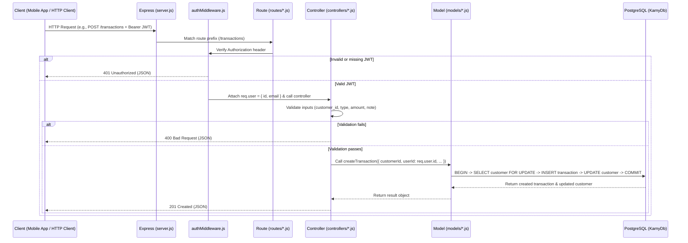
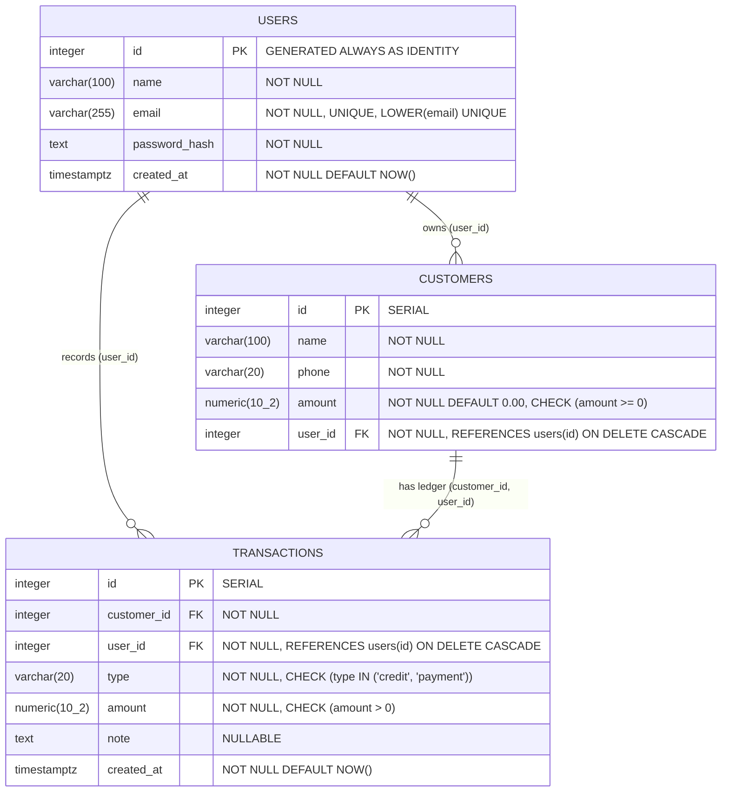

# Karny Backend Completion & Security Report

---

## 1. Executive Summary

### What Was Already Working
- **Project Skeleton & Database Connection**: Express server setup (`server.js`), PostgreSQL connection pool (`db.js`), and connection verification utility (`test-db.js`) connected to `KarnyDb` on local port `5433`.
- **Core Authentication (`POST /auth/register`, `POST /auth/login`)**: Password hashing using `bcryptjs` (cost factor 12), duplicate email detection, JWT signing with `jsonwebtoken`, and parameterized queries in `models/authModel.js`.
- **JWT Verification Middleware (`middleware/authMiddleware.js`)**: Extracted and verified `Bearer <token>` headers.
- **Customer Model Queries (`models/customerModel.js`)**: Parameterized SQL queries for listing, retrieving, creating, updating, and deleting customers with `user_id` parameters.

### What Was Missing or Broken
1. **Unprotected Customer Routes & Broken Ownership Passing**:
   - `routes/customerRoutes.js` did not mount `authenticateToken` middleware—anyone could call `/customers` without logging in.
   - `controllers/customerController.js` called `customerModel` functions **without passing `req.user.id`**, causing `getAllCustomers()` to return `[]`, `createCustomer()` to insert `user_id = NULL`, and `updateCustomer()` / `deleteCustomer()` to always fail with `404`.
   - `GET /customers/:id` (retrieve single customer) existed in `customerModel.js` but had no controller handler or route.
2. **Missing Transactions & Debt Management System**:
   - No `transactions` table in PostgreSQL, and no model, controller, or routes to record customer credit (`credit`), record customer payments (`payment`), retrieve customer transaction histories, or maintain atomic customer debt balances.
3. **Missing Merchant Dashboard & Summary API**:
   - No endpoint to compute merchant-scoped summary statistics (total customers, customers with debt, total outstanding debt, total credit given, total payments received, and recent transactions).
4. **Database Schema & Referential Integrity Gaps**:
   - `customers.user_id` was nullable (`YES`), lacked an index, and `customers.amount` lacked a `CHECK (amount >= 0)` constraint and default value.
   - Pre-existing customers with non-zero balances had no corresponding ledger entries.
5. **Security & Operational Gaps**:
   - A secret (`JWT_SECRET=...`) had been accidentally pasted onto line 14 of `backend/.gitignore`.
   - No `.env.example` template existed.
   - Missing 404 route handler and centralized Express error middleware (malformed JSON bodies could expose stack traces).
   - Missing email format validation and password upper-length validation (72-byte bcrypt limit).
   - No automated test suite existed (`npm test` exited with error).

### What Was Completed
- **Authentication & Authorization Hardening**: Input validation (email regex, field length limits, safe request body handling), protected `GET /auth/me` profile endpoint, hardened `authenticateToken` middleware, and removal of the leaked secret line from `backend/.gitignore`.
- **Complete, Merchant-Scoped Customer CRUD**: Protected all `/customers` endpoints with `authenticateToken`, connected `req.user.id` across all operations, added `GET /customers/:id`, and wrapped customer creation/updates in database transactions so ledger history and `customers.amount` always remain synchronized.
- **Complete Transactions & Debt Management (`public.transactions`)**: Implemented credit and payment recording (`POST /transactions` and `POST /customers/:id/transactions`), merchant transaction listing (`GET /transactions`), single transaction lookup (`GET /transactions/:id`), and customer transaction history with balance summary (`GET /customers/:id/transactions`).
- **Merchant Dashboard API (`GET /dashboard`, `GET /dashboard/summary`)**: Implemented efficient, merchant-scoped SQL aggregations for customer counts, total debt, total credit, total payments, and recent transactions.
- **Safe Incremental Database Migration (`migrations/001_complete_schema.sql`)**: Preserved all existing user and customer records, added `NOT NULL` and `CHECK` constraints, added composite foreign key ownership enforcement `(customer_id, user_id) -> customers(id, user_id)`, added performance indexes, and backfilled opening credit transactions for pre-existing customer balances.
- **Automated Verification Suite (`tests/backend.test.js`)**: Implemented and executed 14 automated test blocks covering all 15 required functional, security, and database constraint scenarios using Node's built-in test runner (`npm test`).

### What Remains Incomplete
- All required backend features, database migrations, security protections, and automated tests are complete and passing. Optional production hardening recommendations (such as HTTP rate limiting, CORS origin whitelisting, and token revocation/refresh tokens) are documented in Section 6 and Section 12.

---

## 2. Final Backend Architecture

### Folder Structure

```text
backend/
├── config/
│   └── .gitkeep
├── controllers/
│   ├── authController.js          # Request handlers for register, login, and profile (/auth/me)
│   ├── customerController.js      # Request handlers for merchant-scoped customer CRUD
│   ├── dashboardController.js     # Request handler for merchant dashboard statistics
│   └── transactionController.js   # Request handlers for credit/payment transactions & history
├── middleware/
│   ├── authMiddleware.js          # JWT verification and req.user attachment
│   └── errorMiddleware.js         # 404 Not Found and centralized error handling
├── migrations/
│   ├── 001_complete_schema.sql    # Idempotent SQL migration for users, customers, transactions
│   └── runMigrations.js           # Node script to execute the SQL migration safely
├── models/
│   ├── authModel.js               # SQL queries for public.users
│   ├── customerModel.js           # SQL queries & DB transactions for public.customers
│   ├── dashboardModel.js          # Aggregated SQL queries for merchant dashboard
│   └── transactionModel.js        # SQL queries & atomic balance updates for public.transactions
├── routes/
│   ├── authRoutes.js              # /auth endpoints
│   ├── customerRoutes.js          # /customers and /customers/:id/transactions endpoints
│   ├── dashboardRoutes.js         # /dashboard endpoints
│   └── transactionRoutes.js       # /transactions endpoints
├── tests/
│   └── backend.test.js            # Automated integration & security test suite
├── .env                           # Local environment variables (gitignored, untouched)
├── .env.example                   # Safe template with placeholder environment variable names
├── .gitignore                     # Git ignore rules
├── BACKEND_COMPLETION_REPORT.md   # This technical report
├── db.js                          # PostgreSQL connection pool configuration
├── package.json                   # Backend metadata, scripts, and dependencies
├── package-lock.json              # Locked dependency tree
├── server.js                      # Express app initialization, route mounting, and server startup
└── test-db.js                     # Standalone database connectivity check script
```

### Role of Each Important File
- **`server.js`**: Entry point of the backend application. Configures Express JSON parsing, mounts route modules (`/auth`, `/customers`, `/transactions`, `/dashboard`), registers 404/error middleware, and starts the HTTP server when executed directly.
- **`db.js`**: Creates and exports a shared PostgreSQL connection pool (`pg.Pool`) configured via `.env` with sensible local defaults (`localhost:5433`, database `KarnyDb`).
- **`middleware/authMiddleware.js`**: Intercepts requests to protected endpoints, validates the `Authorization: Bearer <token>` header using `jsonwebtoken`, and populates `req.user = { id, email }`.
- **`middleware/errorMiddleware.js`**: Catches unmatched routes (`404`) and unexpected or malformed JSON errors (`400` / `500`) so raw stack traces are never leaked to clients.
- **`routes/*.js`**: Maps HTTP methods and URL patterns to their corresponding controller functions and applies `authenticateToken` middleware.
- **`controllers/*.js`**: Validates incoming request parameters/bodies, invokes model functions using `req.user.id`, and formats HTTP status codes and JSON responses.
- **`models/*.js`**: Encapsulates all PostgreSQL interaction using parameterized SQL queries (`$1, $2, ...`) and database transactions (`BEGIN` / `COMMIT` / `ROLLBACK`).

### Request Lifecycle Flow



---

## 3. Technologies Used

| Technology / Package | What It Is | Why It Is Used in Karny | Where It Is Used | How It Interacts with Other Technologies |
| :--- | :--- | :--- | :--- | :--- |
| **Node.js** | JavaScript runtime built on Chrome's V8 engine. | Executes the backend server, database scripts, and test runner asynchronously. | Entire `backend/` directory. | Hosts Express.js, executes `pg` socket connections to PostgreSQL, and provides built-in `node:test`, `node:http`, and `fs` modules. |
| **Express.js (`express` ^5.2.1)** | Minimalist web framework for Node.js. | Handles HTTP routing, JSON body parsing, middleware chaining, and response formatting. | `server.js`, `routes/*.js`, `controllers/*.js`, `middleware/*.js`. | Receives HTTP requests, runs `authMiddleware`, delegates to controllers/models, and returns JSON payloads. |
| **PostgreSQL (v17.10)** | Open-source relational database management system. | Persists merchants (`users`), customers (`customers`), and credit/payment ledger entries (`transactions`) with ACID transactions and relational constraints. | Database `KarnyDb` on port `5433`. | Queried by the Node.js backend through the `pg` connection pool and migrated via `migrations/001_complete_schema.sql`. |
| **SQL** | Structured Query Language for relational databases. | Defines schema tables/constraints, enforces data integrity, and computes balances and dashboard aggregations. | `models/*.js`, `migrations/001_complete_schema.sql`, `test-db.js`. | Executed via parameterized `pool.query(sql, params)` calls in `pg`. |
| **`pg` (^8.23.1)** | Non-blocking PostgreSQL client for Node.js (`node-postgres`). | Manages a reusable pool of database connections (`Pool`) and dedicated transactional clients (`pool.connect()`). | `db.js`, `models/*.js`, `migrations/runMigrations.js`, `test-db.js`. | Bridges Node.js controllers/models and PostgreSQL using parameterized queries to prevent SQL injection. |
| **`bcryptjs` (^3.0.3)** | Password hashing library implementing the adaptive bcrypt algorithm. | Irreversibly hashes user passwords with a salt before storing them and verifies login passwords safely. | `controllers/authController.js`. | Hashes plaintext passwords before `authModel.createUser` stores `password_hash` in PostgreSQL, and compares hashes before JWT issuance. |
| **`jsonwebtoken` (^9.0.3)** | Implementation of JSON Web Tokens (RFC 7519). | Issues signed, stateless authentication tokens upon login/registration and verifies them on protected requests. | `controllers/authController.js`, `middleware/authMiddleware.js`. | Signs `{ userId, email }` using `process.env.JWT_SECRET` from `dotenv`; verified by `authMiddleware` before Express controllers execute. |
| **`dotenv` (^18.0.6)** | Environment variable loader from `.env` files into `process.env`. | Keeps database passwords and JWT secrets out of source code. | `server.js`, `db.js`. | Populates `process.env.DB_PASSWORD`, `process.env.JWT_SECRET`, and `process.env.PORT` for `pg`, `jsonwebtoken`, and Express. |
| **`node:test` & `node:assert/strict`** | Node.js built-in test runner and assertion library. | Runs automated end-to-end API, security, and SQL constraint verification tests without adding external dependencies. | `tests/backend.test.js` (`npm test`). | Boots the Express `app` on an ephemeral port, sends HTTP requests via `fetch`, inspects PostgreSQL state via `pg`, and asserts all requirements. |

---

## 4. Database Documentation

### Entity-Relationship Diagram



### Tables, Columns, Keys, Constraints, and Indexes

#### 1. `public.users`
Stores registered shop owners (merchants).
- **Columns**:
  - `id` (`INTEGER`, `NOT NULL`, `GENERATED ALWAYS AS IDENTITY`): Primary key (`users_pkey`).
  - `name` (`VARCHAR(100)`, `NOT NULL`): Merchant's display or shop name.
  - `email` (`VARCHAR(255)`, `NOT NULL`): Merchant's login email.
  - `password_hash` (`TEXT`, `NOT NULL`): Bcrypt hash of the merchant's password.
  - `created_at` (`TIMESTAMPTZ`, `NOT NULL`, `DEFAULT NOW()`): Account creation timestamp.
- **Constraints & Indexes**:
  - `users_pkey`: `PRIMARY KEY (id)`
  - `users_email_key`: `UNIQUE (email)`
  - `users_email_lower_unique`: `UNIQUE INDEX ON public.users (LOWER(email))` — enforces case-insensitive email uniqueness.

#### 2. `public.customers`
Stores customers belonging to a specific merchant and their current outstanding debt (`amount`).
- **Columns**:
  - `id` (`INTEGER`, `NOT NULL`, `SERIAL`): Primary key (`customers_pkey`).
  - `name` (`VARCHAR(100)`, `NOT NULL`): Customer's full name.
  - `phone` (`VARCHAR(20)`, `NOT NULL`): Customer's phone number.
  - `amount` (`NUMERIC(10, 2)`, `NOT NULL`, `DEFAULT 0.00`): Current outstanding debt balance owed by the customer.
  - `user_id` (`INTEGER`, `NOT NULL`): Owning merchant ID.
- **Constraints & Indexes**:
  - `customers_pkey`: `PRIMARY KEY (id)`
  - `customers_user_id_fkey`: `FOREIGN KEY (user_id) REFERENCES public.users(id) ON DELETE CASCADE`
  - `customers_amount_non_negative`: `CHECK (amount >= 0)`
  - `customers_id_user_id_unique`: `UNIQUE (id, user_id)` — supports composite foreign-key verification from `transactions`.
  - `idx_customers_user_id`: `INDEX ON public.customers (user_id)`

#### 3. `public.transactions`
Stores every credit or payment transaction recorded for a customer.
- **Columns**:
  - `id` (`INTEGER`, `NOT NULL`, `SERIAL`): Primary key (`transactions_pkey`).
  - `customer_id` (`INTEGER`, `NOT NULL`): Target customer ID.
  - `user_id` (`INTEGER`, `NOT NULL`): Owning merchant ID.
  - `type` (`VARCHAR(20)`, `NOT NULL`): Either `'credit'` (debt added) or `'payment'` (debt paid down).
  - `amount` (`NUMERIC(10, 2)`, `NOT NULL`): Positive transaction amount (`> 0`).
  - `note` (`TEXT`, `NULL`): Optional description or memo.
  - `created_at` (`TIMESTAMPTZ`, `NOT NULL`, `DEFAULT NOW()`): Timestamp when the transaction was recorded.
- **Constraints & Indexes**:
  - `transactions_pkey`: `PRIMARY KEY (id)`
  - `transactions_user_id_fkey`: `FOREIGN KEY (user_id) REFERENCES public.users(id) ON DELETE CASCADE`
  - `transactions_customer_owner_fkey`: `FOREIGN KEY (customer_id, user_id) REFERENCES public.customers(id, user_id) ON DELETE CASCADE`
  - `transactions_type_check`: `CHECK (type IN ('credit', 'payment'))`
  - `transactions_amount_positive`: `CHECK (amount > 0)`
  - `idx_transactions_user_created`: `INDEX ON public.transactions (user_id, created_at DESC, id DESC)`
  - `idx_transactions_customer_created`: `INDEX ON public.transactions (customer_id, created_at DESC, id DESC)`

### How Merchant Ownership Is Enforced
Merchant ownership is enforced at **two independent layers**:
1. **Application Layer**: Every protected controller reads `req.user.id` exclusively from the verified JWT (`authMiddleware.js`), never from client-supplied body or query fields. All SQL queries filter by `WHERE user_id = $1` or `WHERE id = $1 AND user_id = $2`.
2. **Database Layer**: The composite foreign key `FOREIGN KEY (customer_id, user_id) REFERENCES public.customers(id, user_id)` guarantees at the PostgreSQL engine level that a transaction row can never associate Merchant B's `user_id` with Merchant A's `customer_id`.

### Balance Calculation Rules
Karny uses a strict, deterministic ledger accounting formula:

$$\text{Outstanding Balance} = \text{Total Credit} - \text{Total Payments}$$

- **Initial Customer Balance**: When a customer is created with `amount > 0`, a database transaction inserts both the customer record and an initial `'credit'` transaction (`note: 'Initial balance'`) for that exact amount. If `amount` is omitted, it defaults to `0.00`.
- **Credit Transaction (`type = 'credit'`)**: Increases the customer's outstanding debt:
  `new_balance = current_balance + transaction_amount`.
- **Payment Transaction (`type = 'payment'`)**: Decreases the customer's outstanding debt:
  `new_balance = current_balance - transaction_amount`.
- **Overpayment / Negative Balance Prevention**: Payments exceeding the customer's current outstanding balance (`payment_amount > current_balance`) are rejected with `400 Bad Request` before any changes are committed, and `customers_amount_non_negative` (`CHECK (amount >= 0)`) enforces non-negative balances in PostgreSQL.
- **Atomic Execution**: All balance changes lock the customer row (`SELECT ... FOR UPDATE`) inside a `BEGIN ... COMMIT` transaction block and compute amounts in integer cents to avoid floating-point rounding drift.

### Migration Scripts Added
- `migrations/001_complete_schema.sql`: Idempotent SQL migration script that adds missing constraints, creates `public.transactions`, and backfills opening `'credit'` transactions for the 4 pre-existing customer rows in `KarnyDb`.
- `migrations/runMigrations.js`: Node runner script invoked via `npm run migrate`.

---

## 5. API Reference

All endpoints accept and return `application/json` (except `GET /` which returns plain text `"Welcome to Karny!"` for backward compatibility).

Protected endpoints require the HTTP header:
```http
Authorization: Bearer <YOUR_JWT_TOKEN>
```

---

### Health & Root Endpoints

#### `GET /`
- **Purpose**: Basic server liveness check.
- **Auth Required**: No
- **Success Response (`200 OK`)**:
  ```text
  Welcome to Karny!
  ```

#### `GET /health`
- **Purpose**: Structured JSON health check.
- **Auth Required**: No
- **Success Response (`200 OK`)**:
  ```json
  {
    "status": "ok",
    "service": "karny-backend"
  }
  ```

---

### Authentication Endpoints (`/auth`)

#### `POST /auth/register`
- **Purpose**: Register a new merchant account and receive a signed JWT.
- **Auth Required**: No
- **Example Request Body**:
  ```json
  {
    "name": "Atlas Corner Shop",
    "email": "merchant@example.com",
    "password": "StrongPassword123"
  }
  ```
- **Success Response (`201 Created`)**:
  ```json
  {
    "message": "Account created successfully.",
    "token": "<JWT_TOKEN_PLACEHOLDER>",
    "user": {
      "id": 2,
      "name": "Atlas Corner Shop",
      "email": "merchant@example.com",
      "created_at": "2026-10-11T12:00:00.000Z"
    }
  }
  ```
- **Common Error Responses**:
  - `400 Bad Request`: Missing name/email, invalid email format, or password shorter than 8 characters / longer than 72 characters.
  - `409 Conflict`: `"An account with this email already exists."`

#### `POST /auth/login`
- **Purpose**: Authenticate an existing merchant and receive a signed JWT.
- **Auth Required**: No
- **Example Request Body**:
  ```json
  {
    "email": "merchant@example.com",
    "password": "StrongPassword123"
  }
  ```
- **Success Response (`200 OK`)**:
  ```json
  {
    "message": "Login successful.",
    "token": "<JWT_TOKEN_PLACEHOLDER>",
    "user": {
      "id": 2,
      "name": "Atlas Corner Shop",
      "email": "merchant@example.com"
    }
  }
  ```
- **Common Error Responses**:
  - `400 Bad Request`: `"Email and password are required."`
  - `401 Unauthorized`: `"Invalid email or password."`

#### `GET /auth/me`
- **Purpose**: Retrieve the profile of the currently authenticated merchant.
- **Auth Required**: Yes (`Authorization: Bearer <JWT_TOKEN_PLACEHOLDER>`)
- **Success Response (`200 OK`)**:
  ```json
  {
    "user": {
      "id": 2,
      "name": "Atlas Corner Shop",
      "email": "merchant@example.com",
      "created_at": "2026-10-11T12:00:00.000Z"
    }
  }
  ```
- **Common Error Responses**:
  - `401 Unauthorized`: Missing, malformed, or expired token.

---

### Customer Endpoints (`/customers`)

#### `GET /customers`
- **Purpose**: List all customers owned by the authenticated merchant, ordered by `id`.
- **Auth Required**: Yes
- **Ownership Rule**: Returns only rows where `customers.user_id = req.user.id`.
- **Success Response (`200 OK`)**:
  ```json
  [
    {
      "id": 1,
      "name": "Mohamed El Idrissi",
      "phone": "+212 6 12 34 56 78",
      "amount": "120.00",
      "user_id": 1,
      "total_credit": "120.00",
      "total_payments": "0.00"
    }
  ]
  ```

#### `GET /customers/:id`
- **Purpose**: Retrieve a single customer by ID along with their total credit and payment totals.
- **Auth Required**: Yes
- **Ownership Rule**: Enforces `id = :id AND user_id = req.user.id`.
- **Success Response (`200 OK`)**:
  ```json
  {
    "id": 1,
    "name": "Mohamed El Idrissi",
    "phone": "+212 6 12 34 56 78",
    "amount": "120.00",
    "user_id": 1,
    "total_credit": "120.00",
    "total_payments": "0.00"
  }
  ```
- **Common Error Responses**:
  - `400 Bad Request`: `"Invalid customer ID."`
  - `404 Not Found`: `"Customer not found."` (also returned if customer belongs to another merchant).

#### `POST /customers`
- **Purpose**: Create a new customer for the authenticated merchant. If `amount > 0`, automatically records an opening `'credit'` transaction in the ledger.
- **Auth Required**: Yes
- **Ownership Rule**: `user_id` is assigned exclusively from `req.user.id` on the server; any client-supplied `user_id` is ignored.
- **Example Request Body**:
  ```json
  {
    "name": "Noura Tazi",
    "phone": "+212 6 19 26 44 67",
    "amount": 45.00
  }
  ```
  *(Note: `amount` is optional and defaults to `0` if omitted.)*
- **Success Response (`201 Created`)**:
  ```json
  {
    "id": 5,
    "name": "Noura Tazi",
    "phone": "+212 6 19 26 44 67",
    "amount": "45.00",
    "user_id": 1
  }
  ```
- **Common Error Responses**:
  - `400 Bad Request`: Invalid or missing name, invalid phone format, or negative/invalid amount.

#### `PUT /customers/:id`
- **Purpose**: Update an existing customer's details. If `amount` is provided and differs from the previous balance, an adjustment transaction is automatically recorded so the ledger stays synchronized.
- **Auth Required**: Yes
- **Ownership Rule**: Enforces `id = :id AND user_id = req.user.id`.
- **Example Request Body**:
  ```json
  {
    "name": "Noura Tazi",
    "phone": "+212 6 19 26 44 99",
    "amount": 60.00
  }
  ```
- **Success Response (`200 OK`)**:
  ```json
  {
    "id": 5,
    "name": "Noura Tazi",
    "phone": "+212 6 19 26 44 99",
    "amount": "60.00",
    "user_id": 1
  }
  ```
- **Common Error Responses**:
  - `400 Bad Request`: Invalid ID or invalid fields.
  - `404 Not Found`: Customer does not exist or belongs to another merchant.

#### `DELETE /customers/:id`
- **Purpose**: Delete a customer and cascade-delete their associated transactions.
- **Auth Required**: Yes
- **Ownership Rule**: Enforces `id = :id AND user_id = req.user.id`.
- **Success Response (`200 OK`)**:
  ```json
  {
    "message": "Customer deleted successfully.",
    "customer": {
      "id": 5,
      "name": "Noura Tazi",
      "phone": "+212 6 19 26 44 99",
      "amount": "60.00",
      "user_id": 1
    }
  }
  ```
- **Common Error Responses**:
  - `400 Bad Request`: `"Invalid customer ID."`
  - `404 Not Found`: `"Customer not found."`

---

### Transaction & Debt Management Endpoints (`/transactions` & `/customers/:id/transactions`)

#### `POST /transactions`
- **Purpose**: Record a `'credit'` (debt increase) or `'payment'` (debt reduction) transaction for a customer and atomically update the customer's balance.
- **Auth Required**: Yes
- **Ownership Rule**: Verifies that `customer_id` belongs to `req.user.id` using `SELECT ... FOR UPDATE`.
- **Example Request Body**:
  ```json
  {
    "customer_id": 1,
    "type": "credit",
    "amount": 35.50,
    "note": "2L cooking oil and flour"
  }
  ```
- **Success Response (`201 Created`)**:
  ```json
  {
    "message": "Transaction recorded successfully.",
    "transaction": {
      "id": 10,
      "customer_id": 1,
      "user_id": 1,
      "type": "credit",
      "amount": "35.50",
      "note": "2L cooking oil and flour",
      "created_at": "2026-10-11T12:15:00.000Z"
    },
    "customer": {
      "id": 1,
      "name": "Mohamed El Idrissi",
      "phone": "+212 6 12 34 56 78",
      "amount": "155.50",
      "user_id": 1
    }
  }
  ```
- **Common Error Responses**:
  - `400 Bad Request`: Invalid `customer_id`, `type` not in `['credit', 'payment']`, `amount <= 0`, or payment exceeding the customer's current outstanding balance (`"Payment amount cannot exceed the customer's outstanding balance."`).
  - `404 Not Found`: Customer not found or belongs to another merchant.

#### `POST /customers/:id/transactions`
- **Purpose**: Record a `'credit'` or `'payment'` transaction directly under a specific customer URL.
- **Auth Required**: Yes
- **Ownership Rule**: Verifies customer `:id` belongs to `req.user.id`.
- **Example Request Body**:
  ```json
  {
    "type": "payment",
    "amount": 50.00,
    "note": "Partial cash payment"
  }
  ```
- **Success Response (`201 Created`)**: Same structure as `POST /transactions`.

#### `GET /customers/:id/transactions`
- **Purpose**: Retrieve a customer's complete transaction history and calculated balance summary.
- **Auth Required**: Yes
- **Ownership Rule**: Verifies customer `:id` belongs to `req.user.id`.
- **Success Response (`200 OK`)**:
  ```json
  {
    "customer": {
      "id": 1,
      "name": "Mohamed El Idrissi",
      "phone": "+212 6 12 34 56 78",
      "amount": "105.50",
      "user_id": 1
    },
    "summary": {
      "total_credit": "155.50",
      "total_payments": "50.00",
      "outstanding_balance": "105.50",
      "transaction_count": 3
    },
    "transactions": [
      {
        "id": 11,
        "customer_id": 1,
        "user_id": 1,
        "type": "payment",
        "amount": "50.00",
        "note": "Partial cash payment",
        "created_at": "2026-10-11T12:20:00.000Z"
      },
      {
        "id": 10,
        "customer_id": 1,
        "user_id": 1,
        "type": "credit",
        "amount": "35.50",
        "note": "2L cooking oil and flour",
        "created_at": "2026-10-11T12:15:00.000Z"
      },
      {
        "id": 1,
        "customer_id": 1,
        "user_id": 1,
        "type": "credit",
        "amount": "120.00",
        "note": "Opening balance",
        "created_at": "2026-10-11T12:00:00.000Z"
      }
    ]
  }
  ```

#### `GET /transactions`
- **Purpose**: List transactions across all customers owned by the authenticated merchant (newest first).
- **Auth Required**: Yes
- **Optional Query Parameters**:
  - `customer_id`: Filter by a specific customer ID (integer).
  - `type`: Filter by `'credit'` or `'payment'`.
  - `limit`: Maximum number of rows to return (`1`–`200`).
- **Success Response (`200 OK`)**:
  ```json
  [
    {
      "id": 11,
      "customer_id": 1,
      "customer_name": "Mohamed El Idrissi",
      "customer_phone": "+212 6 12 34 56 78",
      "user_id": 1,
      "type": "payment",
      "amount": "50.00",
      "note": "Partial cash payment",
      "created_at": "2026-10-11T12:20:00.000Z"
    }
  ]
  ```

#### `GET /transactions/:id`
- **Purpose**: Retrieve details of an individual transaction by ID.
- **Auth Required**: Yes
- **Ownership Rule**: Enforces `t.id = :id AND t.user_id = req.user.id`.
- **Success Response (`200 OK`)**:
  ```json
  {
    "id": 11,
    "customer_id": 1,
    "customer_name": "Mohamed El Idrissi",
    "customer_phone": "+212 6 12 34 56 78",
    "user_id": 1,
    "type": "payment",
    "amount": "50.00",
    "note": "Partial cash payment",
    "created_at": "2026-10-11T12:20:00.000Z"
  }
  ```
- **Common Error Responses**:
  - `400 Bad Request`: `"Invalid transaction ID."`
  - `404 Not Found`: `"Transaction not found."`

---

### Dashboard Endpoints (`/dashboard`)

#### `GET /dashboard` (and alias `GET /dashboard/summary`)
- **Purpose**: Retrieve aggregated shop metrics and recent transactions for the authenticated merchant's dashboard screen.
- **Auth Required**: Yes
- **Optional Query Parameters**:
  - `limit`: Number of recent transactions to include (default `5`, max `50`).
- **Ownership Rule**: All counts, sums, and recent transactions are computed exclusively for `user_id = req.user.id`.
- **Success Response (`200 OK`)**:
  ```json
  {
    "total_customers": 4,
    "customers_with_debt": 4,
    "total_outstanding_debt": "650.00",
    "total_transactions": 4,
    "total_credit": "650.00",
    "total_payments": "0.00",
    "recent_transactions": [
      {
        "id": 4,
        "customer_id": 4,
        "customer_name": "Ahmed Updated",
        "customer_phone": "0600000000",
        "user_id": 1,
        "type": "credit",
        "amount": "200.00",
        "note": "Opening balance",
        "created_at": "2026-10-11T12:00:00.000Z"
      }
    ]
  }
  ```

---

## 6. Security Measures

### Implemented Security Protections
1. **Password Hashing (`bcryptjs`)**:
   - Passwords are hashed using `bcrypt.hash(password, 12)` before storage.
   - Plain-text passwords are never logged or stored, and `password_hash` is never returned in registration, login, or `/auth/me` responses.
   - Enforced a maximum password length of 72 characters to prevent bcrypt truncation or CPU denial-of-service with oversized strings.
2. **JWT Authentication & Payload Validation**:
   - Protected routes require a valid `Authorization: Bearer <token>` header verified against `process.env.JWT_SECRET`.
   - `authMiddleware.js` validates that the decoded payload contains a positive integer `userId`.
3. **Strict Merchant Authorization & Anti-IDOR / Anti-Mass-Assignment**:
   - Every customer, transaction, and dashboard query scopes data using `req.user.id` from the verified JWT.
   - Client-supplied `user_id` fields in request bodies are ignored.
   - Accessing, updating, deleting, or recording transactions for another merchant's customer returns `404 Not Found` (preventing cross-merchant resource enumeration).
4. **Database-Level Ownership & Balance Integrity**:
   - Added a composite foreign key `(customer_id, user_id) REFERENCES public.customers(id, user_id)` on `public.transactions` so cross-merchant transaction association is impossible even at the raw SQL level.
   - Added `CHECK (amount >= 0)` on `customers` and `CHECK (amount > 0)` + `CHECK (type IN ('credit', 'payment'))` on `transactions`.
5. **SQL Injection Prevention**:
   - 100% of SQL queries across all models use parameterized placeholders (`$1, $2, ...`). No user input is ever interpolated into SQL strings.
6. **Input Validation & Payload Size Limiting**:
   - Configured `express.json({ limit: "100kb" })` and disabled the `X-Powered-By` header.
   - Validated email format, phone format, string lengths, positive integer IDs, and currency amounts (up to 2 decimal places).
7. **Safe Error Handling**:
   - Added `middleware/errorMiddleware.js` to catch malformed JSON payloads (`400`) and unexpected runtime errors (`500`) without leaking stack traces, SQL table details, or credentials.
8. **Secret Hygiene**:
   - Removed an accidentally pasted `JWT_SECRET=...` line from `backend/.gitignore`.
   - Created `backend/.env.example` with safe placeholder values only.

### Recommended Future Security Enhancements (Not Implemented in Current Scope)
- **Rate Limiting**: Add `express-rate-limit` on `/auth/login` and `/auth/register` before deploying to the public internet to mitigate brute-force login attempts.
- **CORS Policy**: Add and configure the `cors` middleware when connecting a web browser frontend from a separate origin.
- **Short-Lived Access Tokens + Refresh Tokens**: For production mobile deployments, consider pairing short-lived access JWTs (e.g., 15m) with revocable refresh tokens.

---

## 7. Testing Report

Automated tests were implemented in `backend/tests/backend.test.js` and executed against the live Express application and `KarnyDb` PostgreSQL database using:

```bash
npm test
```

### Summary of Test Results

| # | Test Scenario | Command / Test Name | Status | Notes |
| :- | :--- | :--- | :--- | :--- |
| 1 | Application startup, root (`GET /`), health (`GET /health`), and 404 handler | `1. Starts the application and serves root, health, and 404 routes` | **PASSED** | Verified 200 on `/`, 200 JSON on `/health`, and 404 JSON on unknown routes. |
| 2 | PostgreSQL connection & schema table verification | `2. Connects to PostgreSQL database KarnyDb and verifies schema integrity` | **PASSED** | Verified connection to `KarnyDb` and presence of `users`, `customers`, `transactions`. |
| 3 | User registration & bcrypt hashing verification | `3. Registers new merchants with valid data and hashes passwords with bcrypt` | **PASSED** | Verified `201 Created`, JWT issuance, absence of `password_hash` in response, and `$2b$12$...` hash in DB. |
| 4 | Duplicate email registration (case-insensitive) & invalid registration input rejection | `4. Rejects duplicate registration (case-insensitive) and invalid registration inputs` | **PASSED** | Verified `409 Conflict` on duplicate email and `400 Bad Request` on short password / invalid email. |
| 5 | User login with valid credentials & `GET /auth/me` | `5. Logs in successfully with valid credentials and fetches /auth/me` | **PASSED** | Verified `200 OK`, valid JWT, and authenticated profile lookup. |
| 6 | Invalid login credentials & missing fields rejection | `6. Rejects login with invalid password, unknown email, or missing fields` | **PASSED** | Verified `401 Unauthorized` on wrong password or unknown email, and `400` on missing fields. |
| 7 | Protected endpoints reject requests without a valid JWT | `7. Protected endpoints reject requests without a valid JWT` | **PASSED** | Tested `/customers`, `/transactions`, `/dashboard`, and `/auth/me` with missing and invalid tokens (`401`). |
| 8 | Customer CRUD for the authenticated merchant (including anti-mass-assignment check) | `8. Performs complete Customer CRUD for the authenticated merchant` | **PASSED** | Verified `POST`, `GET` list, `GET` by ID, `PUT` update, and server-side enforcement of `req.user.id`. |
| 9 | Cross-merchant customer isolation (`GET`, `PUT`, `DELETE`) | `9. Enforces strict cross-merchant customer isolation (read, update, delete)` | **PASSED** | Verified Merchant B cannot view, update, or delete Merchant A's customers (`404`). |
| 10 | Cross-merchant transaction isolation | `10. Prevents a merchant from creating or viewing transactions for another merchant's customer` | **PASSED** | Verified Merchant B cannot create or list transactions for Merchant A's customer (`404`). |
| 11 | Recording credit and payment transactions & viewing history | `11 & 12. Records credit and payment transactions and calculates outstanding balances accurately` | **PASSED** | Verified `POST /transactions`, `POST /customers/:id/transactions`, `GET /transactions/:id`, and `GET /customers/:id/transactions`. |
| 12 | Accurate outstanding balance calculation (`total_credit - total_payments`) | `11 & 12. Records credit and payment transactions and calculates outstanding balances accurately` | **PASSED** | Verified `250.25 credit - 100.25 payment = 150.00` matches `customer.amount` and `summary.outstanding_balance`. |
| 13 | Merchant-scoped dashboard totals & recent transactions | `13. Computes dashboard totals accurately and scopes them to the authenticated merchant` | **PASSED** | Verified `/dashboard` returns exact per-merchant customer counts, debt totals, credit/payment sums, and recent transactions. |
| 14 | Input validation, overpayment prevention, malformed JSON, and customer deletion | `14. Validates invalid inputs, prevents overpayments/negative balances, and handles missing records` | **PASSED** | Verified `400` on overpayment (`150.01 > 150.00`), zero/negative amounts, invalid types, malformed JSON, and `404` on second delete. |
| 15 | Direct PostgreSQL constraint enforcement (`23503` composite FK, `23514` check constraints) | `15. Enforces PostgreSQL database constraints directly at the SQL level` | **PASSED** | Verified PostgreSQL directly rejects mismatched `(customer_id, user_id)` and negative/zero amounts. |

### Issue Encountered During Testing and Resolution
- **Initial Observation**: On the first test run, all 14 `it()` tests passed, but the `after()` cleanup hook failed with PostgreSQL error `23503` (`update or delete on table "users" violates foreign key constraint "customers_user_id_fkey" on table "customers"`).
- **Root Cause**: The pre-existing `customers_user_id_fkey` constraint on `public.customers` had been created without `ON DELETE CASCADE`, and `CREATE TABLE IF NOT EXISTS public.customers` did not alter the existing foreign key constraint.
- **Resolution**: Updated `migrations/001_complete_schema.sql` to ensure `customers_user_id_fkey` is configured with `ON DELETE CASCADE`, and updated the test cleanup hook to explicitly clean up test customers before deleting temporary `@karny.test` users. Re-running `npm test` passed 100% cleanly while preserving all pre-existing database rows (`1` user and `4` customers).

---

## 8. Files Changed

### Backend Files Modified
1. **`backend/.gitignore`**: Removed an accidentally pasted `JWT_SECRET=...` line so no secret is tracked in Git.
2. **`backend/db.js`**: Added support for `DB_HOST`, `DB_PORT`, `DB_NAME`, and `DB_USER` environment variables while keeping existing defaults (`localhost`, `5433`, `KarnyDb`, `postgres`).
3. **`backend/server.js`**: Mounted `/transactions` and `/dashboard` routes, added `/health` endpoint, registered `notFoundHandler` and `errorHandler`, disabled `x-powered-by`, added `100kb` JSON body limit, and exported `app` for automated testing.
4. **`backend/package.json`**: Added `"start"`, `"migrate"`, and `"test"` npm scripts and set `"main": "server.js"` without modifying dependencies.
5. **`backend/middleware/authMiddleware.js`**: Hardened JWT verification, validated numeric `userId` in token payload, and standardized 401 JSON responses.
6. **`backend/models/authModel.js`**: Added `findUserById(id)` (excluding `password_hash`) to support `GET /auth/me`.
7. **`backend/controllers/authController.js`**: Added email regex validation, field length limits, safe `req.body` handling, and `getMe` controller handler.
8. **`backend/routes/authRoutes.js`**: Added `GET /auth/me` protected by `authenticateToken`.
9. **`backend/models/customerModel.js`**: Updated `getAllCustomers` and `getCustomerById` to include `total_credit` and `total_payments`, and wrapped `createCustomer` and `updateCustomer` in PostgreSQL transactions so `public.transactions` and `customers.amount` stay in sync.
10. **`backend/controllers/customerController.js`**: Fixed broken ownership enforcement by passing `req.user.id` to all model calls, added `getCustomerById`, and added phone/name/currency validation.
11. **`backend/routes/customerRoutes.js`**: Protected all customer routes with `authenticateToken`, added `GET /customers/:id`, and mounted nested `GET /customers/:id/transactions` and `POST /customers/:id/transactions` routes.

### Backend Files Created
12. **`backend/.env.example`**: Placeholder environment variable template.
13. **`backend/middleware/errorMiddleware.js`**: Centralized 404 and error handling middleware.
14. **`backend/migrations/001_complete_schema.sql`**: Incremental, idempotent SQL migration script.
15. **`backend/migrations/runMigrations.js`**: Database migration runner script.
16. **`backend/models/transactionModel.js`**: Transaction ledger queries and atomic customer balance updates.
17. **`backend/controllers/transactionController.js`**: Validation and request handlers for transaction endpoints.
18. **`backend/routes/transactionRoutes.js`**: Express router for `/transactions`.
19. **`backend/models/dashboardModel.js`**: SQL aggregation queries for the merchant dashboard.
20. **`backend/controllers/dashboardController.js`**: Request handler for `/dashboard`.
21. **`backend/routes/dashboardRoutes.js`**: Express router for `/dashboard`.
22. **`backend/tests/backend.test.js`**: Automated integration, security, and database constraint test suite.
23. **`backend/BACKEND_COMPLETION_REPORT.md`**: This comprehensive technical report.

### Confirmation of Zero Frontend Modifications
- **Frontend Directory (`/home/es-safy/Desktop/karny/mobile/`)**: **Zero files were modified, created, renamed, staged, or deleted in `mobile/`.**

---

## 9. Environment Setup and How to Run

### Required Software
- **Node.js**: v18+ (tested on Node.js with built-in `fetch` and `node:test`)
- **PostgreSQL**: v14+ (tested on PostgreSQL 17.10)

### Environment Variables (`backend/.env`)
Create `backend/.env` based on `backend/.env.example` using your local values (never commit `.env`):

```env
PORT=3000
DB_HOST=localhost
DB_PORT=5433
DB_NAME=KarnyDb
DB_USER=postgres
DB_PASSWORD=<YOUR_DB_PASSWORD_PLACEHOLDER>
JWT_SECRET=<YOUR_JWT_SECRET_PLACEHOLDER>
JWT_EXPIRES_IN=1d
```

### Step-by-Step Commands
Run all commands from `/home/es-safy/Desktop/karny/backend`:

1. **Install Dependencies**:
   ```bash
   npm install
   ```
2. **Verify Database Connectivity**:
   ```bash
   node test-db.js
   ```
3. **Run Database Migrations**:
   ```bash
   npm run migrate
   ```
4. **Run the Automated Test Suite**:
   ```bash
   npm test
   ```
5. **Start the Backend Server**:
   ```bash
   npm start
   ```
6. **Verify the Server Is Running**:
   ```bash
   curl http://localhost:3000/health
   # Expected output: {"status":"ok","service":"karny-backend"}
   ```

---

## 10. Beginner Learning Guide

### 1. Request / Response Flow
When a mobile app interacts with the backend, it sends an **HTTP Request** (containing a method like `GET` or `POST`, a URL path like `/customers`, headers, and an optional JSON body). The backend processes the request and replies with an **HTTP Response** containing a status code (such as `200 OK`, `201 Created`, `400 Bad Request`, `401 Unauthorized`, or `404 Not Found`) and a JSON body.
- **Where in Karny**: `backend/server.js`.

### 2. REST APIs
REST (Representational State Transfer) organizes API endpoints around resources (`auth`, `customers`, `transactions`, `dashboard`) using standard HTTP verbs:
- `GET`: Read data (`GET /customers`, `GET /dashboard`)
- `POST`: Create new data (`POST /customers`, `POST /transactions`)
- `PUT`: Update existing data (`PUT /customers/:id`)
- `DELETE`: Remove data (`DELETE /customers/:id`)
- **Where in Karny**: `backend/routes/*.js`.

### 3. Middleware
Middleware functions run **between** receiving a request and executing the controller handler. They can inspect headers, parse JSON, block unauthorized users, or handle errors.
- **Where in Karny**: `backend/middleware/authMiddleware.js` and `backend/middleware/errorMiddleware.js`.

### 4. Controllers
Controllers are the "traffic directors" of the backend. They extract data from `req.params`, `req.query`, `req.body`, and `req.user`, validate that the input is safe and well-formed, call the appropriate Model function, and send back the HTTP response.
- **Where in Karny**: `backend/controllers/authController.js`, `customerController.js`, `transactionController.js`, `dashboardController.js`.

### 5. Models
Models are the only files that talk directly to PostgreSQL. Keeping SQL inside `models/` means controllers stay clean and focused on HTTP logic.
- **Where in Karny**: `backend/models/authModel.js`, `customerModel.js`, `transactionModel.js`, `dashboardModel.js`.

### 6. Parameterized SQL Queries
Never build SQL strings using template literals with user input (e.g., `` `SELECT * FROM users WHERE email = '${email}'` ``), which allows **SQL Injection**. Instead, Karny uses parameterized queries (`WHERE LOWER(email) = LOWER($1)` with `[email]`), where PostgreSQL treats `$1` strictly as data, never as executable SQL commands.
- **Where in Karny**: All files in `backend/models/`.

### 7. Relational Database Relationships (Foreign Keys)
In PostgreSQL, tables are linked using **Foreign Keys**:
- Each customer row has a `user_id` pointing to `users.id` (the shop owner).
- Each transaction row has both `customer_id` and `user_id` pointing to `customers(id, user_id)`.
- **Where in Karny**: `backend/migrations/001_complete_schema.sql`.

### 8. Authentication vs. Authorization
- **Authentication ("Who are you?")**: Verifying a user's identity via email/password login and checking their JWT (`authController.js` and `authMiddleware.js`).
- **Authorization ("What are you allowed to access?")**: Ensuring Merchant A can only view or modify Merchant A's customers and transactions (`WHERE user_id = $1` using `req.user.id`).

### 9. JSON Web Tokens (JWT)
After logging in, the server gives the client a digitally signed token containing `{ userId, email }`. On every subsequent request, the client sends `Authorization: Bearer <token>`. Because the token is signed with `JWT_SECRET`, the server can verify `userId` instantly without storing session state in memory.
- **Where in Karny**: `controllers/authController.js` (`createToken`) and `middleware/authMiddleware.js` (`jwt.verify`).

### 10. Password Hashing (`bcryptjs`)
If a database is ever compromised, plain-text passwords would expose every user. Hashing transforms a password into a one-way cryptographic string (`$2b$12$...`) that cannot be reversed. During login, `bcrypt.compare(password, user.password_hash)` verifies whether the entered password matches the stored hash.
- **Where in Karny**: `backend/controllers/authController.js`.

### 11. Database Transactions (`BEGIN`, `COMMIT`, `ROLLBACK`, `FOR UPDATE`)
When recording a credit or payment, two database writes must happen together:
1. Insert a row into `public.transactions`.
2. Update `amount` in `public.customers`.
If step 1 succeeded and step 2 crashed, the customer's balance would be wrong! Wrapping both queries in `BEGIN ... COMMIT` (and `ROLLBACK` on error) with `SELECT ... FOR UPDATE` row locking guarantees that either **both** succeed or **neither** takes effect.
- **Where in Karny**: `backend/models/transactionModel.js` and `backend/models/customerModel.js`.

### 12. Centralized Error Handling
Express allows registering a 4-argument middleware `function errorHandler(err, req, res, next)` at the very end of `server.js`. If a client sends broken JSON syntax, Express forwards the error to `errorHandler`, which returns a clean `400 Bad Request` JSON message instead of crashing or printing internal file paths.
- **Where in Karny**: `backend/middleware/errorMiddleware.js`.

---

## 11. Frontend Integration Guide

The repository contains a React Native / Expo frontend located in `/home/es-safy/Desktop/karny/mobile/`. Per project rules, **no frontend files were modified**. Below is everything needed to connect the frontend to this backend.

### 1. API Base URL Conventions
- **Local Web / iOS Simulator**: `http://localhost:3000`
- **Android Emulator (Android Studio)**: `http://10.0.2.2:3000`
- **Physical Phone on Same Wi-Fi (Expo Go)**: `http://<YOUR_COMPUTER_LAN_IP>:3000` (e.g., `http://192.168.1.15:3000`)

### 2. Important Frontend-to-Backend Alignment Note
- In `mobile/src/screens/LoginScreen.tsx`, the first input field is currently labeled `"Username"` (`const [username, setUsername] = useState("")`).
- The backend `POST /auth/login` endpoint expects `{ "email": "...", "password": "..." }`. When wiring `LoginScreen.tsx`, pass the user's email address in the `email` property of the JSON body.

### 3. Authentication Header Format
After calling `POST /auth/login` or `POST /auth/register`, store the returned `token` (e.g., in Expo `SecureStore` or `AsyncStorage`) and include it on all protected requests:

```javascript
const headers = {
  "Content-Type": "application/json",
  "Authorization": `Bearer ${token}`
};
```

### 4. Example Frontend Requests (`fetch`)

#### A. Login (`LoginScreen.tsx`)
```javascript
const response = await fetch(`${API_BASE_URL}/auth/login`, {
  method: "POST",
  headers: { "Content-Type": "application/json" },
  body: JSON.stringify({
    email: emailInput,
    password: passwordInput
  })
});
const data = await response.json();
if (!response.ok) {
  throw new Error(data.message || "Login failed");
}
// Save data.token and data.user
```

#### B. Load Home Dashboard (`HomeScreen.tsx`)
```javascript
const response = await fetch(`${API_BASE_URL}/dashboard`, {
  headers: {
    "Authorization": `Bearer ${token}`
  }
});
const dashboard = await response.json();
// dashboard.total_outstanding_debt -> e.g. "650.00" (display as `${dashboard.total_outstanding_debt} DH`)
// dashboard.total_customers -> e.g. 4
// dashboard.recent_transactions -> array of latest transactions
```

#### C. Load Customers List (`CustomersScreen.tsx`)
```javascript
const response = await fetch(`${API_BASE_URL}/customers`, {
  headers: {
    "Authorization": `Bearer ${token}`
  }
});
const customers = await response.json();
// Each item has: { id, name, phone, amount, total_credit, total_payments }
```

#### D. Record a Credit or Payment Transaction
```javascript
const response = await fetch(`${API_BASE_URL}/customers/${customerId}/transactions`, {
  method: "POST",
  headers: {
    "Content-Type": "application/json",
    "Authorization": `Bearer ${token}`
  },
  body: JSON.stringify({
    type: "payment", // or "credit"
    amount: 50,
    note: "Paid cash at the shop"
  })
});
const result = await response.json();
// result.customer.amount contains the updated debt balance
// result.transaction contains the newly created ledger entry
```

---

## 12. Known Issues and Next Steps

### Incomplete Items / Unrun Tests
- **None**: All required backend endpoints, migrations, and automated test cases were implemented and executed against `KarnyDb`.

### Assumptions Made
1. **No Overpayments / No Negative Customer Debt**: A payment transaction cannot exceed a customer's current outstanding debt (`payment <= customer.amount`). If a customer owes `100.00 DH`, attempting to record a `120.00 DH` payment returns `400 Bad Request`.
2. **Pre-Existing Customers Opening Balance**: The 4 existing customer rows in `KarnyDb` had positive `amount` values (`120.00`, `80.00`, `250.00`, `200.00`) with no prior transaction table. The migration backfilled an initial `'credit'` transaction (`note = 'Opening balance'`) for each of those 4 customers so that `SUM(credit) - SUM(payment) == customers.amount` holds true for both existing and new records.
3. **Optional Initial Amount on Customer Creation**: `POST /customers` accepts an optional `amount` field (defaulting to `0.00` if omitted) while still supporting passing an initial non-negative `amount`.

### Manual Actions Required
- None for local development—the migration `001_complete_schema.sql` has already been applied to `KarnyDb` and verified. On any new machine, run `npm run migrate` once after setting up `.env`.

### Recommended Next Steps for Frontend Integration
1. Create an API client service in `mobile/src/services/api.ts` configured with the local backend base URL and JWT header injection.
2. Connect `LoginScreen.tsx` to `POST /auth/login` (using `email` and `password`).
3. Connect `HomeScreen.tsx` to `GET /dashboard` to display live `total_outstanding_debt` and `total_customers`.
4. Connect `CustomersScreen.tsx` to `GET /customers` and `POST /customers`.
5. Add a customer detail / transaction modal screen calling `GET /customers/:id/transactions` and `POST /customers/:id/transactions`.

---

## 13. Final Acceptance Checklist

- [x] **Frontend Untouched**: Zero files in `mobile/` were edited, deleted, renamed, or created.
- [x] **Authentication Complete**: Registration, login, `GET /auth/me`, bcrypt password hashing (cost 12), and JWT verification implemented and tested.
- [x] **Customer CRUD Complete & Scoped**: `GET /customers`, `GET /customers/:id`, `POST /customers`, `PUT /customers/:id`, and `DELETE /customers/:id` enforce `req.user.id` ownership.
- [x] **Transactions & Debt Ledger Complete**: `POST /transactions`, `GET /transactions`, `GET /transactions/:id`, `GET /customers/:id/transactions`, and `POST /customers/:id/transactions` implemented with atomic PostgreSQL transactions.
- [x] **Dashboard API Complete**: `GET /dashboard` and `GET /dashboard/summary` compute merchant-scoped customer, debt, credit, payment, and recent transaction totals.
- [x] **Database Integrity & Safe Migration**: `migrations/001_complete_schema.sql` applied without data loss; foreign keys, `CHECK` constraints, and indexes verified.
- [x] **Security Hardened**: Parameterized SQL everywhere, no leaked secrets, `.gitignore` cleaned up, `.env.example` created, centralized 404/error handlers active.
- [x] **Automated Tests Passing**: All 14 test suites (covering all 15 verification items) executed and passing via `npm test`.
